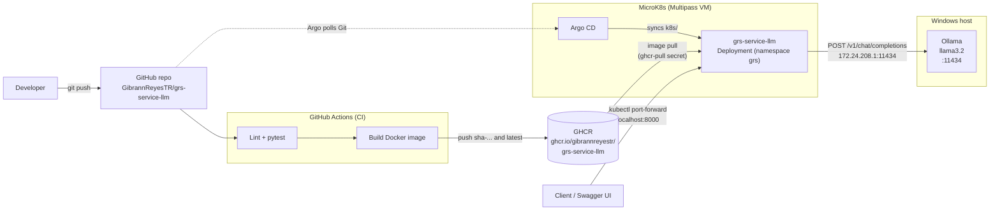
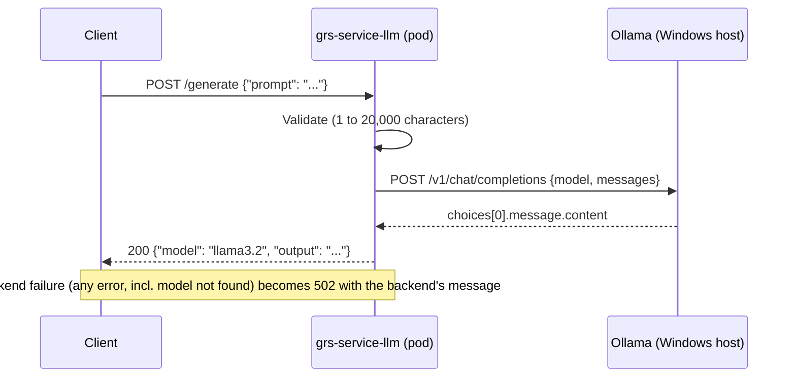

# grs-service-llm

A small FastAPI service that exposes a single `/generate` endpoint and forwards prompts to an
OpenAI-compatible LLM backend (currently Ollama running `llama3.2`).

It is built and tested by GitHub Actions, and deployed to a local MicroK8s cluster by Argo CD.

## Architecture (current)



| Component | Role |
|---|---|
| **FastAPI service** ([main.py](main.py), [llm.py](llm.py)) | Validates the request and calls the LLM backend. Stateless. |
| **Ollama** | Runs the model. Lives on the Windows host, outside the cluster (see [why](#known-limitations)). |
| **GitHub Actions** ([.github/workflows/ci.yml](.github/workflows/ci.yml)) | Lints, runs the tests, builds the image and pushes it to GHCR (push to `main` only). |
| **GHCR** | Private container registry holding the image. |
| **Argo CD** ([argocd/application.yaml](argocd/application.yaml)) | Watches `k8s/` on `main` and keeps the `grs` namespace in sync (auto-sync, prune, self-heal). |
| **MicroK8s** | Local single-node Kubernetes cluster running in a Multipass VM. Setup notes: [docs/microk8s-setup.md](docs/microk8s-setup.md). |

### Request flow



### Delivery flow

1. Push to `main`.
2. GitHub Actions runs `ruff` and `pytest`; if they pass, it builds the image and pushes it to GHCR.
3. Argo CD detects changes under `k8s/` in Git and applies them to the cluster.

> The cluster currently runs the `latest` tag. A new image is **not** rolled out automatically yet,
> because nothing in Git changes when CI publishes it (see [Known limitations](#known-limitations)).

## API

| Method | Path | Description |
|---|---|---|
| `GET` | `/health` | Returns `{"status": "ok", "model": "<model>"}`. |
| `POST` | `/generate` | Body `{"prompt": "<1-20000 chars>"}`. Returns `{"model": "...", "output": "..."}`. |

Interactive docs (Swagger UI) are served at `/docs`.

```bash
curl -X POST http://localhost:8000/generate \
  -H "Content-Type: application/json" \
  -d '{"prompt": "Explain HTS codes in one sentence"}'
```

Errors: `422` for an invalid body, `502` when the LLM backend fails (the response includes the backend's message).

## Configuration

All settings are environment variables read in [llm.py](llm.py).

| Variable | Default | Purpose |
|---|---|---|
| `LLM_BASE_URL` | `http://localhost:11434/v1` | OpenAI-compatible base URL. In the cluster it is set in [k8s/api.yaml](k8s/api.yaml). |
| `LLM_MODEL` | `llama3.2` | Model name sent to the backend. |
| `LLM_API_KEY` | `not-needed` | Bearer token sent to the backend (Ollama ignores it). |
| `LLM_TIMEOUT` | `60` | Backend timeout in seconds (the cluster sets `120`; CPU inference is slow). |

## Run locally

Requires Python 3.11 and a running Ollama with the model pulled (`ollama pull llama3.2`).

```powershell
python -m venv .venv
.\.venv\Scripts\Activate.ps1
pip install -r requirements-dev.txt
uvicorn main:app --reload --port 8000    # Swagger UI: http://localhost:8000/docs
```

Tests and lint (the LLM backend is mocked, no Ollama needed):

```powershell
ruff check .
pytest
```

## Operate on MicroK8s

```powershell
kubectl -n argocd get application grs-service-llm   # expect Synced / Healthy
kubectl -n grs get pods                              # expect 1/1 Running
kubectl -n grs port-forward svc/grs-service-llm 8000:80
```

Then open http://localhost:8000/docs and call `POST /generate`. Keep the port-forward window open;
re-run it after the pod restarts.

**Prerequisites on the Windows host:** Ollama must be running and listening on all interfaces
(`OLLAMA_HOST=0.0.0.0:11434`), because the pod reaches it through the Multipass VM's gateway address.

## Repository layout

```
main.py, llm.py          FastAPI app and LLM client
tests/                   pytest tests (backend mocked)
Dockerfile               Python 3.11 slim image, runs as non-root
.github/workflows/       CI: lint, test, build, push to GHCR
k8s/                     Manifests synced by Argo CD (Kustomize)
k8s/optional/            Not synced: run Ollama inside the cluster instead
argocd/                  Argo CD Application definition
docs/                    Reference docs (see below)
```

## Known limitations

- **Image tag is `latest`.** Kubernetes keeps the running pod until something changes in Git. Planned:
  CI commits the new `sha-<commit>` tag into [k8s/kustomization.yaml](k8s/kustomization.yaml) so Argo CD
  rolls it out automatically.
- **Ollama runs on the Windows host, not in the cluster.** The Ollama image (about 3.6 GB in its largest
  layer) downloaded at roughly 0.1 MB/s through the corporate proxy, so the in-cluster setup was not
  practical. The manifests for it are kept in [k8s/optional/ollama-incluster.yaml](k8s/optional/ollama-incluster.yaml).
- **Host address is hard-coded.** `172.24.208.1` is the Hyper-V Default Switch address and can change
  after a reboot; update `LLM_BASE_URL` in [k8s/api.yaml](k8s/api.yaml) if it does.
- **Ollama is unauthenticated and listens on all adapters** on the host. Keep the Windows firewall in
  mind, and do not use this setup beyond a development machine.
- **The registry pull secret (`ghcr-pull`) is created by hand** in the `grs` namespace and is not stored in Git.
- The service has no authentication, request logging or rate limiting.

## More documentation

- [docs/microk8s-setup.md](docs/microk8s-setup.md): MicroK8s on Multipass behind Zscaler (setup and troubleshooting notes). Reference only.
- [docs/gcp-architecture-proposal.md](docs/gcp-architecture-proposal.md): proposed equivalent architecture on Google Cloud.
