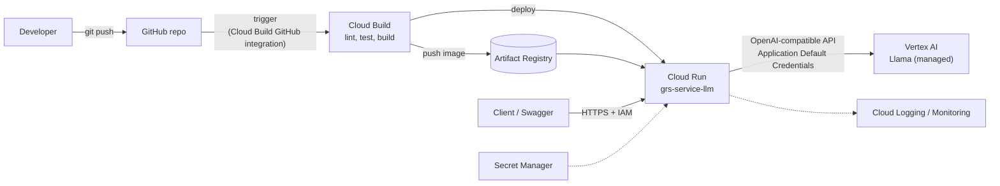
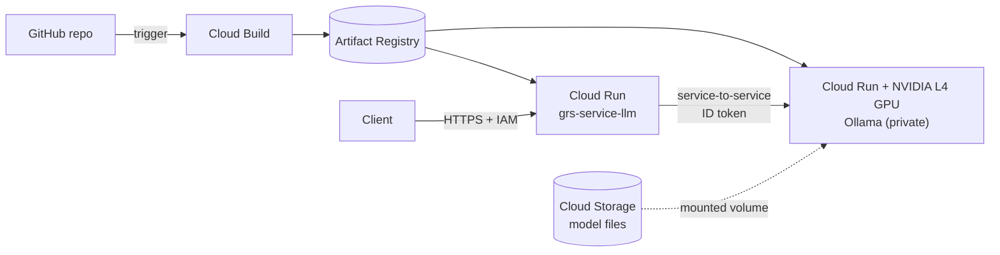

# Proposal: grs-service-llm on Google Cloud

**Status:** proposal, nothing here is implemented. **Written:** 2026-10-09.

This describes how the current architecture (see the [main README](../README.md)) could run entirely on
Google Cloud services, and which design I would pick.

## Assumptions

- "Google Cloud only" means the **build, registry, deployment, hosting, model, secrets and observability**
  all use Google Cloud services. **GitHub stays as the source repository**, connected to Google Cloud.
  Replacing the repository host is out of scope.
- The API stays a small, stateless FastAPI service with the same `/generate` contract.
- Details marked *to verify* were not confirmed and need checking before building.

## Today vs Google Cloud

| Concern | Today | Google Cloud equivalent |
|---|---|---|
| CI (lint, test, build) | GitHub Actions | **Cloud Build** trigger on the GitHub repo |
| Image registry | GHCR | **Artifact Registry** |
| CD / GitOps | Argo CD on MicroK8s | **Cloud Build deploy step** (single env) or **Cloud Deploy** (dev, staging, prod promotion) |
| API hosting | Pod on MicroK8s | **Cloud Run** (or GKE, option C) |
| Model | Ollama + `llama3.2` on a Windows host | **Vertex AI** managed Llama (option A) or **Ollama on Cloud Run GPU** (option B) |
| Secrets (pull secret, keys) | Hand-made Kubernetes secret | **Secret Manager** and service-account identity (no pull secret needed) |
| Logs and metrics | `kubectl logs` | **Cloud Logging and Cloud Monitoring** (automatic on Cloud Run) |
| Access control | None | **IAM** (private Cloud Run, invoker role), optionally IAP or API Gateway for end users |

## Option A (recommended): Cloud Run + Vertex AI managed Llama

**Why it fits.** Vertex AI exposes Llama through an **OpenAI-compatible Chat Completions endpoint**
(`.../endpoints/openapi/chat/completions`), and the model is called with a Google Cloud access token. The
current service already speaks that protocol, so the code change is small and there is no model server to run.

**Code changes (small):**
- [llm.py](../llm.py): instead of the static `LLM_API_KEY`, get a short-lived access token from Application
  Default Credentials (the `google-auth` package) and refresh it when it expires.
- `LLM_BASE_URL` becomes the Vertex endpoint
  `https://<LOCATION>-aiplatform.googleapis.com/v1beta1/projects/<PROJECT>/locations/<LOCATION>/endpoints/openapi`,
  and `LLM_MODEL` becomes a Vertex model ID such as `meta/llama-4-scout-17b-16e-instruct-maas`.
- The request payload (`model`, `messages`) does not change.

**Pros:** no GPUs or model files to manage, scales to zero, least code and least operations.
**Cons:** per-token cost, and the model is whatever Vertex offers, so output will differ from `llama3.2`.

**Things to verify before building:**
- Which Llama models are available, and in which regions (the Google example used `us-east5`). The documented
  example is Llama 4, not Llama 3.2.
- The Llama Community License must be accepted once on the model's Model Garden card before it can be called.
- Whether your organisation allows sending prompts to Vertex AI (data residency, policy).

## Option B: Cloud Run + self-hosted Ollama on Cloud Run GPU

Closest to the current "API plus separate model server" design.

- Cloud Run supports **NVIDIA L4 GPUs**, and Google publishes a tutorial for running Ollama on them.
  From that tutorial: GPU needs `--gpu 1 --gpu-type nvidia-l4`, CPU throttling off (`--no-cpu-throttling`),
  `--concurrency` matched to `OLLAMA_NUM_PARALLEL`, and `--max-instances` no higher than your L4 quota.
- Keep the Ollama service private (`--no-allow-unauthenticated`). The API's service account gets the Cloud
  Run invoker role, and [llm.py](../llm.py) sends a Google-signed **ID token** whose audience is the Ollama
  service URL.
- Model weights should come from a Cloud Storage volume or be baked into the image, so each cold start does
  not download them. Both approaches appear in Google's and third-party guides; pick one after testing.

**Pros:** you control the exact model (including `llama3.2`), and prompts stay in your own services.
**Cons:** GPU quota must be requested, cold starts are slower, and you own model packaging and versions.

## Option C: GKE (closest to MicroK8s)

Run the existing [k8s/](../k8s) manifests on GKE, with a GPU node pool for Ollama and Artifact Registry
for images. It reuses the most of today's setup, but adds cluster operations. *Not researched in detail:*
the GitOps tool to use on GKE (Argo CD again, or a Google-provided option) should be evaluated first.

## Comparison

| | A: Cloud Run + Vertex AI | B: Cloud Run + GPU Ollama | C: GKE |
|---|---|---|---|
| Operations effort | Lowest | Medium | Highest |
| Code change | Small (auth + config) | Small (ID token) | None to small |
| Exact model control | No | Yes | Yes |
| GPU quota needed | No | Yes | Yes |
| Scale to zero | Yes | Yes (with cold starts) | Not by default |
| Reuses current manifests | No | No | Yes |

## Delivery pipeline (all options)

1. A **Cloud Build trigger** on pushes to `main` runs `cloudbuild.yaml`: install, `ruff`, `pytest`, build the
   image, push it to Artifact Registry.
2. **Single environment:** the same file ends with a `gcloud run deploy` step that deploys the new image.
   **Several environments:** Cloud Build creates a **Cloud Deploy** release, which promotes it through dev,
   staging and prod with optional approvals.
3. The image is tagged with the commit SHA, so every deployment is traceable (this also fixes today's
   "`latest` is not rolled out automatically" limitation).

GitHub can be connected either with the Cloud Build GitHub integration or with Developer Connect.

## Security notes

- Keep Cloud Run **private** and grant `roles/run.invoker` only to the callers that need it. For human users,
  put IAP or API Gateway in front.
- Use **dedicated service accounts** with least privilege: one for Cloud Build (push to Artifact Registry,
  deploy), one for the API (call Vertex AI or invoke the Ollama service).
- Store any configuration secret in **Secret Manager**, never in the manifests or the repo. No registry
  pull secret is needed, because Cloud Run pulls from Artifact Registry with its service account.
- This removes today's unauthenticated Ollama listener on a developer machine.

## Recommendation

Start with **Option A**. It is the smallest change, has no GPU or model operations, and lets you prove the
pipeline (Cloud Build, Artifact Registry, Cloud Run) end to end quickly. Move to **Option B** only if you
need a specific model such as `llama3.2`, or cannot send prompts to a managed model API.

## Open questions

1. Is a managed model API (Vertex AI) acceptable for the data this service will see?
2. Must the model be exactly `llama3.2`, or is another Llama version fine?
3. Is one environment enough, or do you need dev, staging and prod (Cloud Deploy)?
4. Which Google Cloud project, region and organisation policies apply?

## Sources checked

- [Request Llama predictions (Vertex AI)](https://docs.cloud.google.com/vertex-ai/generative-ai/docs/partner-models/llama/use-llama)
- [Llama 4 as MaaS on Vertex AI (Google Developers Blog)](https://developers.googleblog.com/en/llama-4-ga-maas-vertex-ai/)
- [Run LLM inference on Cloud Run GPUs with Ollama (tutorial)](https://cloud.google.com/run/docs/tutorials/gpu-gemma2-with-ollama)
- [Cloud Run GPU announcement (Google Cloud blog)](https://cloud.google.com/blog/products/application-development/run-your-ai-inference-applications-on-cloud-run-with-nvidia-gpus)
- [Continuous deployment for Cloud Run](https://docs.cloud.google.com/run/docs/continuous-deployment)
